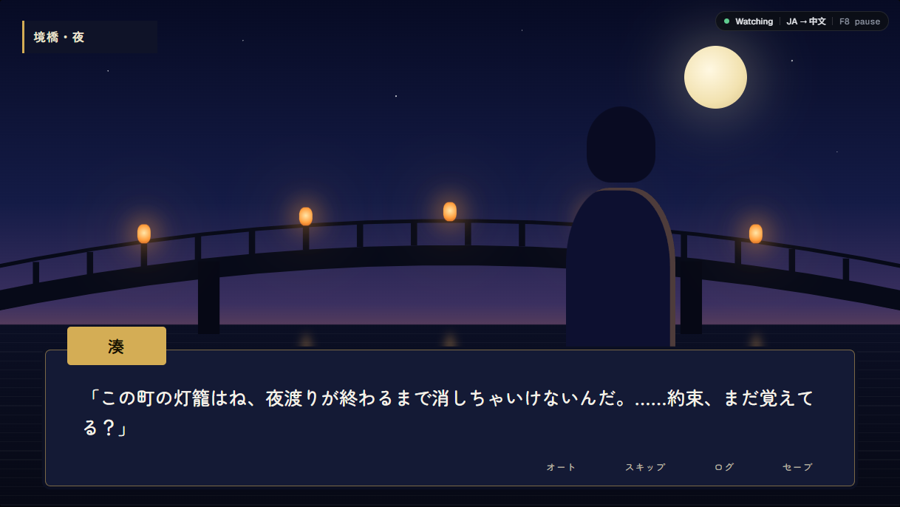
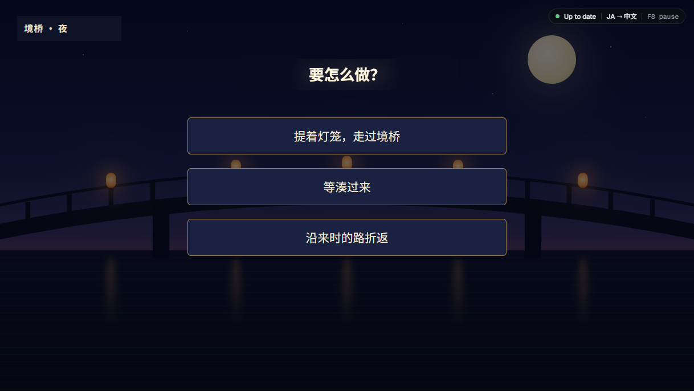

# Translator Overlay

Play a game in your language without touching its files. A click-through window sits over the game, watches it, and paints translations where the original text was.

| Original | With the overlay |
|---|---|
|  |  |

*Screens from the project's design mockups, made with the fictional test game in `app/test/game`.*

- Works on any game that runs in a window: visual novels, RPGs, menus, choices, labels.
- Reads the screen, so nothing is injected into the game and no files are patched.
- Translations keep each game's names and terms consistent through a per-game profile and glossary, drafted automatically the first time you play.
- Text it has seen before is painted from memory instantly, with no new request.
- Three ways to show a translation: in place over the original, as a subtitle band above it, or in a side panel on a second monitor.

Windows 10 or 11 only. Translation is done by Google's Gemini models through your own API key.

## Install

You need [Node.js](https://nodejs.org/) 20 or newer and [Git](https://git-scm.com/).

```bash
git clone https://github.com/WizardShawn/translator-overlay.git
cd translator-overlay/app
npm install
```

Then double-click `Translator Overlay.cmd` in the project folder.

## Add your Gemini key

1. Create a key at [Google AI Studio](https://aistudio.google.com/apikey).
2. In the app, open **Settings** and press **Add key**, then paste it.

The key is encrypted with your Windows account (DPAPI) and stored in `config/gemini-key.dpapi.json`. Only your account on this PC can read it, and `.gitignore` keeps it out of the repository.

Pick the language to translate into under **Settings › Translate into**. The game's language is detected automatically.

## Play

Run the game in borderless or windowed mode. Nothing can draw over exclusive fullscreen.

On the **Games** page, pick the game under **Open windows** and press **Start overlay**, or press **F8** while the game is in front.

| Key | Does |
|---|---|
| F8 | Start or pause |
| Hold Alt | Show the original text |
| F9 | Translate this screen again, skipping memory |
| F10 | Open the session log |
| Ctrl+F8 | Draw areas to ignore or read |

Keys can be changed in Settings.



## What leaves your PC, and what it costs

- Each time new text appears, the changed parts of the game window are cropped and sent to the Gemini API, with the game's profile, glossary and the last few lines of dialogue.
- On a game's first play, one extra request sends the window title, the executable's product and company name, a little on-screen text and one picture of the window, with Google Search turned on, so the model can identify the game.
- Requests are billed to your Google account at Gemini's prices. The free tier covers light use. Repeated screens cost nothing, since they come from memory.
- Everything else stays local, under `data/`: each game's profile, translation memory, your corrections, a transcript and the log.

## How a line gets translated

1. The engine scans the game window about 8 times a second on a small grayscale copy split into cells.
2. Cells that keep moving are treated as animation and ignored. So are the cells under the mouse pointer.
3. When changed cells stop changing for 200 ms, they are grouped into a region and cropped at full resolution.
4. If the same region was seen before, its translation is painted from memory at once.
5. Otherwise the crop goes to Gemini with the translator prompt, the game profile, the glossary and the last 12 lines. Gemini returns each text block's position, source and translation, streamed one block at a time.
6. Each box is tightened onto the actual letters. The background colour is sampled around it, and the translation is painted on a patch of that colour. Text over busy artwork gets a blurred plate instead.
7. A patch hides the moment the pixels under it change, and comes back if they change back.

On a game's first play, a separate call identifies the game and drafts its profile. A background call then adds new characters and terms as they appear, and never touches entries you edited.

## Files

| Where | What |
|---|---|
| `app/` | The Electron app |
| `config/` | The prompts and the key scripts, plus your `settings.json` and encrypted key once created. See [config/README.md](config/README.md). |
| `data/games/<game>/` | `profile.json`, `cache.json` (screen memory), `memory.json` (first translation of each text), `edits.json` (your fixes), `transcript.jsonl`, `zones.json` |
| `data/app.log` | Errors and session events |
| `mockups/` | The HTML design mockups of every screen |

The prompts in `config/` are plain Markdown. Edit them to change how the translator writes.

## Development

```bash
cd app
npm test               # unit tests: no screen, no network
npm run test:overlay   # renders sample blocks in the real overlay page (uses your installed Google Chrome)
npm run probe          # sends a test frame to Gemini and prints the blocks and timing (uses your key)
npm start
```

`app/test/e2e.ps1` opens the test game in a Chrome window, runs the app against it with debug flags and saves screenshots. It takes over part of the screen while it runs.

Debug flags: `--start=<title text>` attaches to a window on launch, `--debug-visible` lets screenshots include the overlay, `--debug-always-show` keeps it up when the game is not in front, `--debug-dump` writes each region crop and block detail to `data/debug`, and `--debug-ui-shots=<dir>,<seconds>` saves a picture of each control-panel page.

## License

[MIT](LICENSE)
