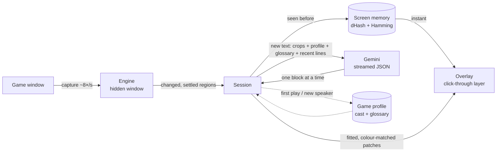

<div align="center">

# Translator Overlay

**Plays a game in your language without touching its files.**

A click-through window sits over the game, watches it, and paints translations where the original text was.

<sub>Windows · Electron · koffi (Win32) · Google Gemini · streamed structured output</sub>

<table>
<tr>
<td width="50%" valign="top"></td>
<td width="50%" valign="top"></td>
</tr>
<tr>
<td align="center"><sub>The game as it ships</sub></td>
<td align="center"><sub>With the overlay running</sub></td>
</tr>
</table>

<sub>Design mockups, made with the fictional test game in <code>app/test/game</code>.</sub>

</div>

## Architecture



Three windows split the work. The **engine** is a hidden renderer that captures the game and decides what changed. The **overlay** is a transparent, always-on-top, click-through window that only paints. The **control panel** picks the game and edits its profile. The main process owns the session, the per-game files and every Gemini call.

## How a line gets translated

1. The engine scans the game window about 8 times a second on a small grayscale copy split into cells.
2. Cells that keep moving are treated as animation and ignored. So are the cells under the mouse pointer.
3. When changed cells stop changing for 200 ms, they are grouped into a region and cropped at full resolution.
4. Each crop carries a difference hash. If a region within a small Hamming distance was seen before, its translation is painted from memory at once, with no request.
5. Otherwise the crop goes to Gemini with the translator prompt, the game profile, the glossary and the last 12 lines. The stable parts sit first so the request prefix stays cacheable. Gemini returns each text block's position, source and translation as JSON, and a streaming parser hands each block to the overlay the moment its object closes.
6. Each box is tightened onto the actual glyphs. The background colour is sampled around it, and the translation is painted on a patch of that colour, fitted to the original box. Text over busy artwork gets a blurred plate instead.
7. A patch hides the moment the pixels under it change, and comes back if they change back.

Requests go to a chain of Gemini models. A model that is rate-limited, erroring, slow to answer or no longer offered is cooled down and the next one takes the call.

## Game profiles

On a game's first play, one call identifies it from its window title, the executable's product and company name, the opening on-screen text and one picture of the window, with Google Search grounding on, and drafts a profile: setting, cast, tone and a glossary. Translation does not wait for it; the draft is picked up when the call returns.

A background call then adds new characters and terms as they appear. It runs when a new speaker name shows up or every 60 lines, never more than once every 5 minutes, and never touches entries the player edited. Every line's first translation is kept, so a name or catchphrase reads the same across the whole game.

## Display

| Mode | What it does |
|---|---|
| Replace in place | The translation covers the original text in the game's own box. |
| Subtitle band | The original stays visible; the translation sits just above it. |
| Side panel | Nothing is drawn over the game; translations appear in the Live session page, for a second monitor. |

Holding **Alt** shows the original under any patch. **Ctrl+F8** draws areas to ignore (a HUD, a ticker) or to always read.

## What leaves the PC

- New text: the changed regions of the game window, cropped, with the game's profile, glossary and recent dialogue.
- First play: the window title, the executable's product and company name, a little on-screen text and one picture of the window.

Requests use the player's own Gemini API key and are billed to that Google account. Repeated screens come from memory and cost nothing. Everything else stays local under `data/`.

## Running it

Windows 10 or 11, [Node.js](https://nodejs.org/) 20 or newer.

```bash
git clone https://github.com/WizardShawn/translator-overlay.git
cd translator-overlay/app
npm install
```

Start it with `Translator Overlay.cmd` in the project folder. In **Settings**, press **Add key** and paste a key from [Google AI Studio](https://aistudio.google.com/apikey). The key is encrypted with the Windows account (DPAPI) and stored in `config/gemini-key.dpapi.json`, which `.gitignore` keeps out of the repository. Choose the language under **Translate into**; the game's language is detected.

Run the game borderless or windowed (nothing can draw over exclusive fullscreen), pick it on the **Games** page, and press **Start overlay** or **F8**.

| Key | Does |
|---|---|
| F8 | Start or pause |
| Hold Alt | Show the original text |
| F9 | Translate this screen again, skipping memory |
| F10 | Open the session log |
| Ctrl+F8 | Draw areas to ignore or read |

## Project layout

| Where | What |
|---|---|
| `app/main.js` | Windows, hotkeys, IPC, the game-window poll |
| `app/engine/` | Capture, change detection, region crops, glyph fitting and colour sampling |
| `app/overlay/` | The click-through layer that paints the patches |
| `app/ui/` | The control panel |
| `app/src/session.js` | One play session: regions in, painted translations out, profile calls |
| `app/src/requests.js` | The bodies of the three Gemini calls |
| `app/src/gemini.js` | Minimal streaming Gemini REST client |
| `app/src/blockstream.js` | Pulls complete blocks out of a JSON reply while it is still streaming |
| `app/src/store.js` | Per-game files: profile, screen memory, first translations, edits, transcript, zones |
| `app/src/win32.js` | Window bounds, foreground, cursor, keys and process path through koffi |
| `config/` | The three prompts (plain Markdown) and the key scripts; see [config/README.md](config/README.md) |
| `mockups/` | HTML design mockups of every screen |
| `docs/` | README images and the script that renders the social preview |

## Tests

```bash
cd app
npm test               # unit tests: stream parsing, game ids, hashing, request bodies, settings merge
npm run test:overlay   # renders sample blocks in the real overlay page in headless Chrome and checks the fit
npm run probe          # sends a fixture frame to Gemini and prints the blocks and timing
```

`app/test/e2e.ps1` opens the test game in a Chrome window, runs the app against it with debug flags and saves screenshots. Debug flags: `--start=<title text>`, `--debug-visible`, `--debug-always-show`, `--debug-dump` (writes each region crop and block to `data/debug`) and `--debug-ui-shots=<dir>,<seconds>`.

## Engineering approach

Designed, specified, directed, and QA'd by the author, and built via AI-driven development. The design work is the authored part: reading the screen instead of hooking the game, waiting for text to settle so typewriter dialogue is translated once, painting from a perceptual-hash memory before ever calling a model, streaming blocks so the first line lands before the reply finishes, and keeping each game's cast and glossary in a profile the model drafts and the player owns.

## License

[MIT](LICENSE)
